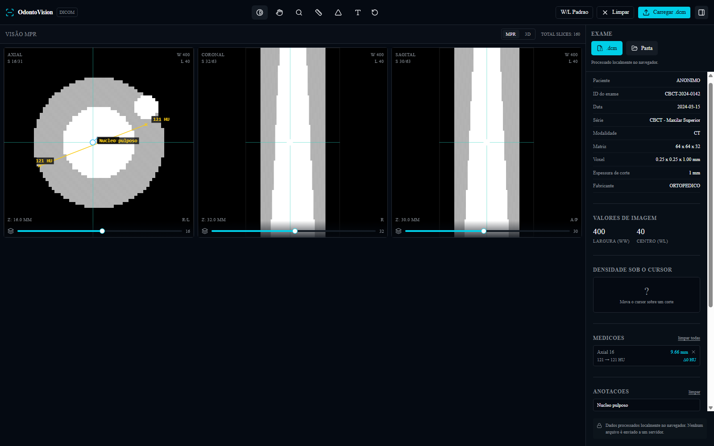
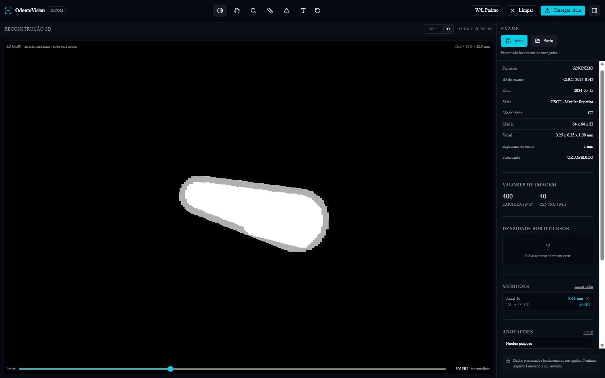

# OdontoVision

Visualizador de tomografia odontológica (CBCT / DICOM) que roda **inteiro no
navegador**. Nenhum arquivo de exame sai do computador: não há backend, upload
nem cadastro. Abrir um `.dcm` e medir sobre ele acontece todo na máquina do
usuário.



## O que faz

- **Abre arquivos DICOM reais** — um `.dcm` sozinho, uma série de cortes, ou um
  arquivo multi-frame. É lido o Transfer Syntax, as tags de identificação, o
  espaçamento entre voxels e o rescale de HU.
- **Três planos de reconstrução (MPR)** — axial, coronal e sagital, com o
  indicador de posição sincronizado entre os três.
- **Reconstrução 3D** por *maximum intensity projection*, com limiar em HU,
  rotação por arraste e zoom. O limiar é o que separa o osso do ar: sem ele a
  imagem sai preta.

  

- **Régua em milímetros**, com a densidade (HU) nas duas pontas e a diferença
  entre elas.
- **Ângulo em graus**, medido em três cliques, com o HU nos três pontos.
- **Anotações de texto** amarradas a um ponto da imagem.
- **Relatório exportável** em texto e em CSV (planilha), com as medidas e as
  anotações e o ponto onde cada rótulo foi colocado.
- **Brilho/contraste, zoom, navegação** e HU sob o cursor.

## Rodando

```bash
npm install
npm run dev        # http://localhost:3000
```

Clique em **"Exame de exemplo"**: um phantom de tomografia é gerado em memória
e aparece na tela. Não precisa baixar nada nem ter arquivo nenhum.

Para abrir um arquivo de verdade, use **"Abrir .dcm"** e escolha um `.dcm` do
seu computador. Nada é enviado para lugar nenhum.

## Decodificando compressão

Tomografia costuma vir comprimida. O visualizador reconhece:

| Transfer Syntax | Situação |
| --- | --- |
| Não comprimido (Explicit/Implicit VR) | Lê |
| RLE Lossless | Decodifica (implementado aqui) |
| JPEG Baseline / Extended, 8 bits | Decodifica (delegado ao navegador) |
| JPEG 2000, JPEG-LS, JPEG Lossless | Recusa, dizendo o motivo |

Para JPEG acima de 8 bits (12/16, o JPEG *Extended*) o navegador não decodifica
e o app recusa **nomeando a precisão**, em vez de dizer apenas "comprimido".

> **Aviso importante:** JPEG é compressão **com perda**. Quando o app mostra o
> HU de uma imagem JPEG, esse número carrega o erro da compressão do arquivo, e
> a tela exibe um aviso sobre isso. Serve para navegar, medir distância e ângulo
> — não para dosagem nem decisão clínica sem conferência.

## Decisões técnicas que valem nota

- **O 3D é MIP ortográfico com limiar em HU.** Um raio paralelo por pixel, e
  fica com o maior HU que passa. É a técnica de sempre em imagem médica; alpha
  blending daria um visual mais bonito e mais lento, sem revelar estrutura a
  mais. **O limiar é a interface, não um detalhe**: sem ele o raio para no ar
  (-1000) e a imagem sai preta.
- **Raio em perspectiva é o erro óbvio.** Construir o raio "da câmera para o
  pixel" faz o raio do canto varrer o volume inteiro na diagonal — a imagem
  ganha osso nos cantos e o limiar deixa de filtrar nada. Ortográfica é
  paralelos: o que muda por pixel é a origem, no plano da câmera.
- **O 3D respeita o tamanho físico, como o MPR.** No phantom o eixo z vale
  1,00 mm por voxel contra 0,25 mm em x e y: sem `voxelSizeMm` o volume
  apareceria 4× mais alto. É a mesma pegadinha do aspecto dos planos, agora em
  três eixos.
- **HU do pixel data encapsulado sai de `planeHuAt`, o mesmo caminho do readout
  sob o cursor.** Ler de outro lugar fazia a régua discordar do número que o
  usuário acabou de ver passando o mouse.
- **Medidas em milímetros usam `planeVoxelSizeMm`, nunca `pixelSpacing` direto.**
  No coronal e no sagital o eixo v é z, que vale `sliceSpacing`. Usar o
  espaçamento errado mede 4× curto — e o sintoma é um número plausível, sem erro
  na tela.
- **Ângulo é calculado em mm, não em voxel.** Numa grade anisotrópica a mesma
  tripla de voxels dá 90,0° no axial e 151,9° no coronal. Calcular na grade dá o
  número do axial em todo plano.
- **`atan2(cruzamento, produto)`, nunca `acos`.** Em ângulo reto o `acos`
  devolve `NaN` — justamente no caso mais comum.
- **Big endian é lido na ordem certa.** `1.2.840.10008.1.2.2` é a única sintaxe
  com bytes big endian; ler ao contrário não dá erro nenhum, o HU sai plausível e
  errado.

O conjunto desses detalhes está em `AGENTS.md`, que é o diário do projeto.

## Testes

Sem framework. Cada `scripts/verify-*.mjs` importa a lib com *type-stripping* do
Node e roda no topo do arquivo.

```bash
npm run verify         # tsc + build + fixtures + 358 checks + E2E
npm run verify:sample  # fixture de 1 corte
npm run verify:volume  # HU, MPR, geometria, medição, ângulo, relatório
npm run verify:series  # monta a série e confere voxel a voxel
npm run e2e            # Chrome headless via CDP: simula uso de verdade
```

O `verify` não depende de rede: quando é preciso um caso difícil (gêmeo big
endian, gêmeo RLE, JPEG gerado pelo navegador), o próprio teste **fabrica** o
arquivo.

Existem dois bugs **silenciosos** que só apareceram com arquivos reais e agora
têm teste de regressão: o big endian lido ao contrário (HU plausível e errado) e
o PackBits do DICOM, em que `0x00` copia um literal e não é no-op (imagem
deslocada a partir do primeiro `0x00`, com os primeiros pixels ainda certos).

## Estrutura

```
app/                     página e layout
components/viewer/       canvas 2D, MPR, 3D e sobreposição de HU
components/layout/       barra superior, painel principal e barra lateral
lib/dicom/               núcleo puro, sem React e sem DOM — é o que o Node testa
  types.ts               tipos do DICOM
  parse.ts               leitura de tags e montagem do volume
  rle.ts                 RLE Lossless (PS3.5 Anexo G)
  jpeg.ts                JPEG Baseline/Extended via createImageBitmap
  phantom.ts             phantom sintético do botão de exemplo
  volume.ts              HU, W/L, MPR, geometria em mm
  volume3d.ts            render 3D por MIP com limiar
  measure.ts             régua e ângulo (puros, testáveis)
  annotate.ts            anotações de texto
  report.ts              relatório em texto e CSV
  series.ts              montagem de série multi-arquivo
store/                   estado (zustand)
scripts/                 geração de fixture, verificadores e captura de tela
```

`lib/dicom/` não importa React nem toca no DOM. É o que permite testar a
matemática de janela/nível, a geometria em milímetros e o ângulo direto no Node,
sem navegador.

## Limites conhecidos

- **Não salva trabalho.** Medidas e anotações somem ao fechar a aba; só o
  relatório exportado fica.
- **Só um volume por vez.** Não há registro de pacientes, nem comparação entre
  exames, nem navegação em série temporal.
- **O 3D não segmenta.** Ele mostra o pico de HU de cada raio, com um limiar
  global. Não há separação automática de estruturas — o canal da mandíbula, o
  nervo e um dente isolado aparecem todos juntos, porque têm densidades
  parecidas. Isolar uma estrutura é segmentação, e precisa de recorte manual ou
  de modelo treinado.
- **O render 3D é JavaScript puro**, sem WebGL. Aguenta o phantom e exames
  pequenos; um CBCT de 512×512×300 seria lento para arrastar.
- **Não decodifica JPEG 2000**, que é o formato mais comum em CBCT
  odontológico. Precisa de um decodificador wavelet próprio.

## Licença e dados

Projeto de portfólio. Nenhum dado real de paciente está no repositório: as
fixtures em `samples/` são sintéticas e regeneráveis, e os arquivos de teste de
terceiros vêm de `pydicom/data/test_files` (`npm run fetch:real`), que são
sintéticos ou publicamente desidentificados.

## Desenvolvimento do OdontoVision

Consulte [o PRD](docs/PRD.md), [o roadmap](docs/ROADMAP.md),
[a arquitetura](docs/ARQUITETURA.md), [o manual multiagente](docs/ORQUESTRACAO.md)
e [a validacao clinica](docs/VALIDACAO-CLINICA.md).

Para executar no Windows, use `INICIAR-ODONTOVISION.cmd` ou siga
[as instrucoes de execucao](docs/EXECUCAO-LOCAL.md). Consulte tambem
[o registro da verificacao](docs/REGISTRO-QA-2026-11-08.md).

O aplicativo e um prototipo para exploracao visual e desenvolvimento. Seu uso
diagnostico depende de validacao tecnica e clinica adicional.
